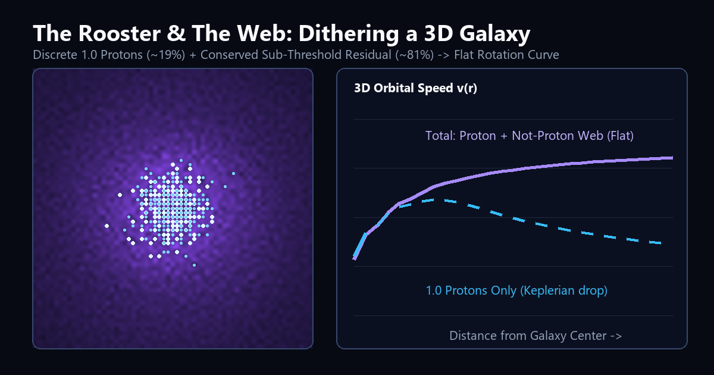

# Dithering Reality — The Rooster & The Web

Interactive browser simulations (zero external dependencies) and a 65-line Python verification script exploring **isotropic 3D error-diffusion quantization** of continuous waves into discrete `1.0` knots ("Protons") and their conserved sub-threshold residual web ("Not-Proton" / Dark Matter).

## Live Interactive Demos

- **[4-Scene Visual Primer (Start Here)](https://dougmcnabb.github.io/dithering-reality/visual-guide.html)** — *The Rooster & The Web*: interactive visual walkthrough from a scale-free wave ocean to local proton frames, relativistic energy, and galactic rotation curves.
- **[Full 3D Error-Diffusion Lab](https://dougmcnabb.github.io/dithering-reality/)** — Live `61³` 3D galaxy simulator, Cosmic Web multi-wave filaments, and Double-Slit dot-by-dot interference dither.



## Verify Locally in Python (~65 lines, NumPy only)

```bash
pip install numpy
python error_diffusion_galaxy.py
```
